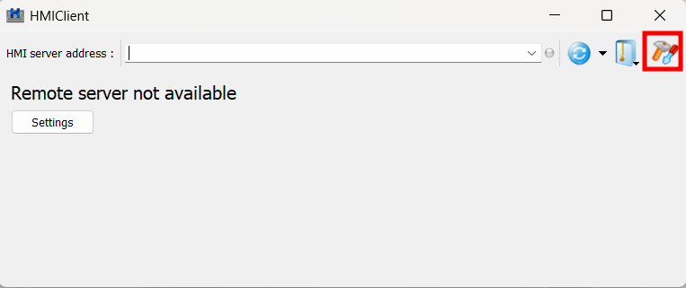

# Install and connect XtreeE Control

*cell operator*{ .badge .role } *per workstation*{ .badge .freq }

[XtreeE Control](../../products/control/index.md) is opened through HMWin
Client. Install it once on each computer used to run the cell. You need the xHEAD
controller switched on, and the computer connected to it.

<!-- TODO: needs source — how the computer is physically connected to the xHEAD controller -->

1. Download and install HMWin Client from the
   [HMWin product page (Panasonic)](https://industry.panasonic.eu/products/automation-devices-solutions/human-machine-interfaces/hmi-programming-software/programming-software-hm-series-hmwin).
   The current version is 4.5.2 build 650.
2. Open HMWin Client and click the settings.
3. Set the server address to `192.168.13.5` and apply **Fit to screen size**.
4. Click **OK**.

    

    

From now on, opening HMWin Client loads XtreeE Control automatically. It is
connected once it displays the
[home screen](../../products/control/index.md#home-screen), with the
**CONTROL**, **SETTINGS**, **INK** and **DATA** pages.

<!-- TODO: needs source — what to do when HMWin Client does not load the home screen -->

**Next:** [Register your equipment in Settings](../printing-cell/register-your-equipment-in-settings.md)
