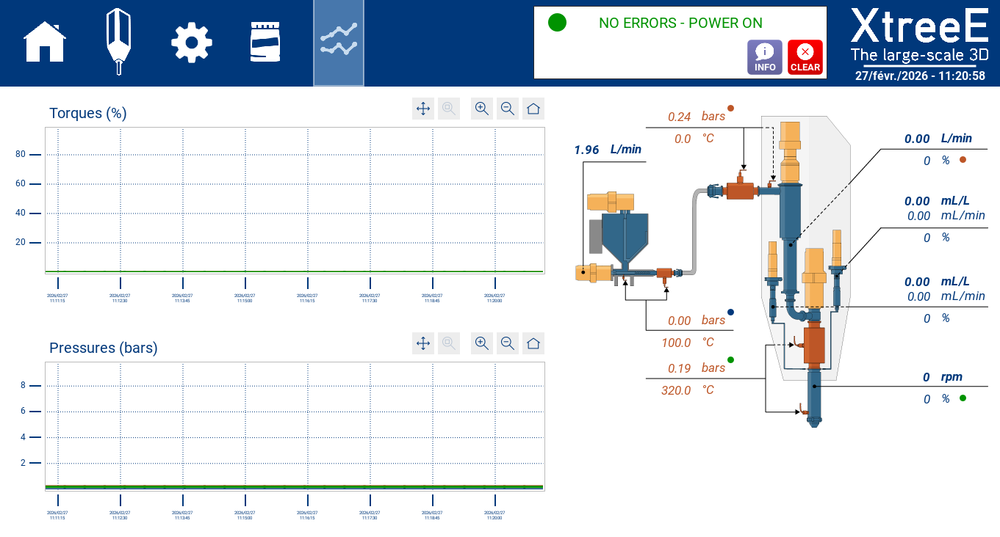
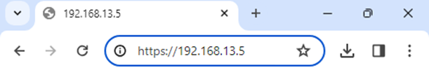

# Data

The **DATA** page of [XtreeE Control](index.md) is the monitoring page. It shows
all the live data, and a 10-minute history of the main data as graphs.

| Colour | Values from |
|---|---|
| Orange | sensors — temperatures, pressures |
| Blue | motors — speeds, torques |

## Graphs

Values marked with a small coloured dot are the ones shown in the graphs, in the
colour of their dot.

## Viewing from a web browser

The monitoring page can also be viewed in a web browser, on any device connected
to the cell network — smartphone, tablet, laptop. Open the browser and go to
`https://192.168.13.5/`.

