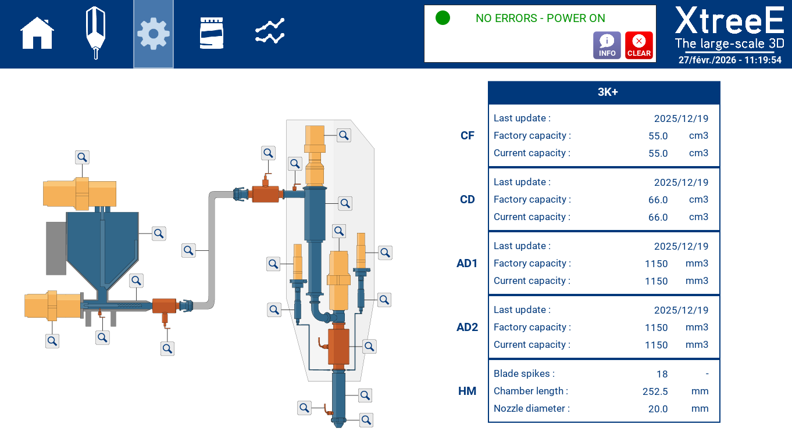
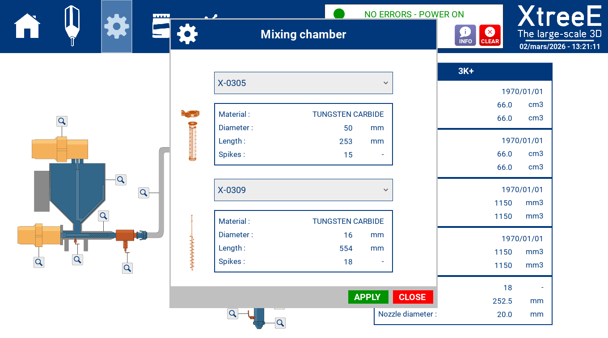
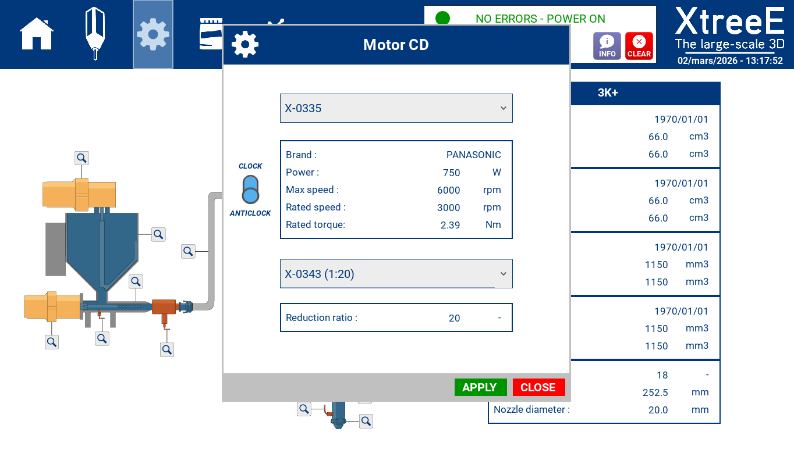
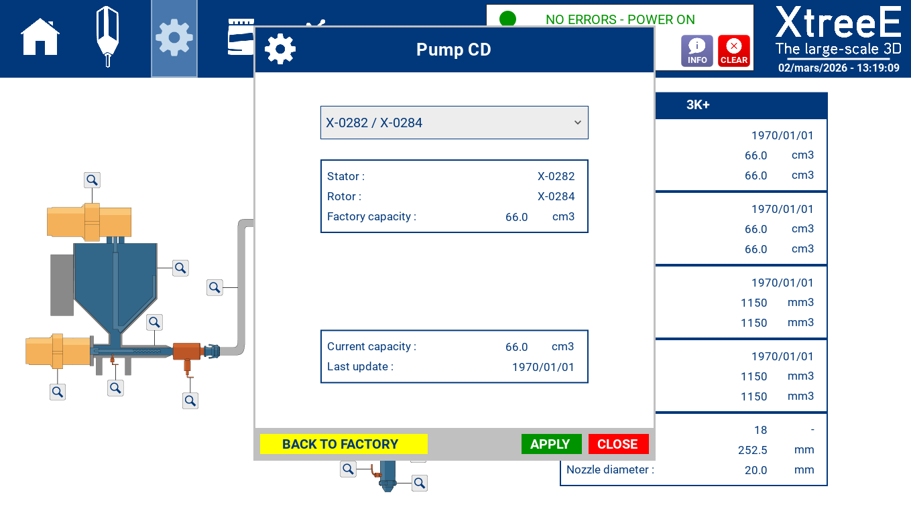

# Settings

The **SETTINGS** page of [XtreeE Control](index.md) defines the equipment and its
references.

## Summary table

A table on the right gathers the most important data of each functional device —
a summary of the system you will print with. Check these values before printing:
[Verify the Settings table against the cell](../../guides/session-startup/verify-the-settings-table-against-the-cell.md).

## Device references

Each device has a small button that opens a window to update its reference.
Select a new reference in the dropdown lists, then click **APPLY**. The
procedure is in
[Register your equipment in Settings](../../cell-installation/printing-cell/register-your-equipment-in-settings.md).

## Pump capacity

For a pump, the window shows the factory capacity and the updated capacity — the
one set by a [pump flow update](index.md#pump-flow-update).

**BACK TO FACTORY** resets the values after a new pump reference is selected:
**APPLY** the new pump first, then reset the value.

